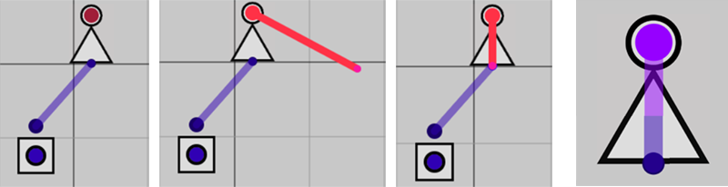

# Logic Circuit Simulator · 数字电路模拟器

一个基于 HTML5 Canvas 的交互式数字逻辑电路模拟器。支持组合逻辑与时序逻辑电路的搭建、仿真与调试。



## 功能特点

- **丰富的元件库** — 包含基本逻辑门（与、或、非、与非、或非、异或）、输入源（恒真、恒假、开关、时钟）、输出灯泡、节点元件以及 D 触发器
- **两种运行模式**
  - **时序模式** — 每帧运行一次，适用于模拟时序电路（锁存器、触发器、计数器等）
  - **组合模式** — 一次性刷新，可开启"更新时运行"选项，电路变化时自动运行，适用于搭建大型组合电路
- **交互操作**
  - 左键拖动 — 移动屏幕、拖动元件、从元件池拖出元件、将多余元件拖回元件池删除
  - 右键操作 — 批量选择、批量移动、右键单击选中部分可复制
  - 连线 — 从输出端口（大圆）拖动至输入端口（小圆）；右键单击导线可删除
  - 节点元件 — 用于引出导线分支或美化连线布局
- **状态指示** — 紫色 = 1（高电平），蓝色 = 0（低电平），红色 = 未定义（输入不足）
- **预设电路** — 内置加法器、解码器、编码器、RS 锁存器、JK 触发器、T 触发器、CLA 加法器等常用电路示例
- **存档功能** — 支持保存和加载电路配置

## 操作指南

### 界面布局

- **右侧** — 元件池与预设电路列表
- **左侧** — 控制面板
- **中央** — 电路绘制区域

### 基本操作

| 操作 | 说明 |
|------|------|
| 长按鼠标左键 + 拖动 | 移动画布视角 |
| 拖拽元件 | 移动元件位置 |
| 从元件池拖出 | 添加新元件 |
| 将元件拖回元件池 | 删除元件 |
| 从输出端口拖动到输入端口 | 连接导线 |
| 右键单击导线 | 删除导线 |
| 长按鼠标右键 + 拖动 | 框选多个元件 |
| 右键单击选中区域 | 复制选中的元件 |

### 连线规则

- 连线只能从端口开始
- 一个输入端口只能连接一条导线（只能与一个输出端口相连）
- 一个输出端口可引出多条导线连接多个输入
- 仅不同类型的端口可以相连（输入 ⇄ 输出），不能连接两个输出端口
- 使用节点元件可在导线中途引出分支或美化布局

### 搭建时序电路

此模拟器支持搭建真实的时序电路，但需要一定的技巧：

1. 确保处于**时序模式**
2. 某些时序电路可能需要一帧以上完成功能
3. 对于环形连接（如将非门输入输出直接相连），需要提前给非门提供输入并为每个端口设置初始值，再从输出引线连接到输入
4. 请注意：环形连接本身是非法的，除锁存器等时序逻辑元件外，请尽量避免

## 元件列表

### 输入/输出
| 元件 | 说明 |
|------|------|
| 恒真 (Always True) | 持续输出高电平 (1) |
| 恒假 (Always False) | 持续输出低电平 (0) |
| 开关 (Switch) | 手动切换 0/1 |
| 时钟 (Clock) | 周期性输出方波信号 |
| 输出灯泡 (Output Bulb) | 显示信号状态 |

### 逻辑门
| 元件 | 说明 |
|------|------|
| 与门 (AND) | 两输入 |
| 或门 (OR) | 两输入 |
| 非门 (NOT) | 单输入反相 |
| 异或门 (XOR) | 两输入 |
| 三输入与门 (3-AND) | 三输入 |
| 三输入或门 (3-OR) | 三输入 |
| 与非门 (NAND) | 两输入 |
| 或非门 (NOR) | 两输入 |

### 其他
| 元件 | 说明 |
|------|------|
| 节点 (Node) | 向上/向下引出导线分支 |
| D 触发器 (D Flip-Flop) | 边沿触发存储单元 |

## 预设电路

本模拟器内置了以下预设电路（位于 `saves/` 与 `newsaves/` 目录）：

- 加法器 (Adder)
- 解码器 (Decoder)
- 优先编码器 (Priority Encoder)
- 减法器 (Subtracter)
- 乘法器 (Multipler)
- CLA 加法器 (Carry Look-Ahead Adder)
- RS 锁存器 (RS Latch)
- 钟控 RS 锁存器 (Clocked RS Latch)
- 主从 RS 触发器 (Master-Slave RS)
- JK 触发器 (JK Flip-Flop)
- T 触发器 (T Flip-Flop)
- D 触发器
- 补码器 (Complementer)
- 计数器 (Counter)
- ……

## 项目结构

```
├── index.html          # 主页面
├── styles.css           # 样式表
├── scripts.js           # 核心逻辑代码
├── credit.html          # 致谢与使用说明页面
├── asset/               # 图片资源
│   ├── and.png
│   ├── or.png
│   ├── not.png
│   ├── xor.png
│   ├── nand.png
│   ├── nor.png
│   ├── orgate.png
│   ├── buttonb.png
│   ├── settingbutton.png
│   ├── false_button.png
│   ├── true_button.png
│   ├── dff.png
│   ├── jk.png
│   ├── tff.png
│   ├── petdff.png
│   ├── msrs.png
│   ├── encoder.png
│   ├── decoder.png
│   ├── dmx.png
│   ├── addrmux.png
│   ├── leftshifter.png
│   ├── rightshifter.png
│   ├── complementer.png
│   ├── counter.png
│   ├── fulladder.png
│   └── demo.png
├── saves/               # 预设电路存档
│   ├── xorgate.txt
│   ├── add.txt
│   ├── coder.txt
│   ├── decoder.txt
│   ├── RS_latch.txt
│   ├── clocked_SR_latch.txt
│   ├── mssr.txt
│   ├── JK.txt
│   ├── T.txt
│   └── addjson.txt
└── newsaves/            # 新版预设电路
    ├── xor.txt
    ├── add.txt
    ├── RSnor.txt
    ├── decoder.txt
    ├── pencoder.txt
    ├── gRS.txt
    ├── msRS.txt
    ├── JK.txt
    ├── CLA.txt
    ├── CLAp.txt
    ├── complementer.txt
    ├── subtracter.txt
    ├── gD.txt
    └── multipler.txt
```

## 致谢

- 浏览器 API、Canvas 绘图 API 部分代码由 DeepSeek 提供
- 数字电路相关知识来源于 [B站视频](https://www.bilibili.com/video/BV1o2KgzpE5K)
- 网页功能与外观设计参考了 [Digital](https://github.com/hneemann/Digital)
- 感谢 [Dif-scope](https://github.com/Dif-scope) 同学提供的美术指导

## 技术栈

- HTML5 Canvas
- 原生 JavaScript
- 纯前端，无外部依赖

## 许可证

本项目使用 [MIT](LICENSE) 许可证开源。
